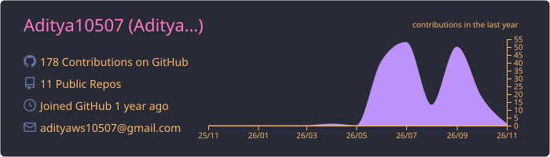
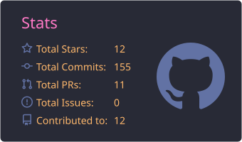
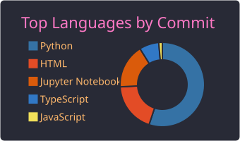
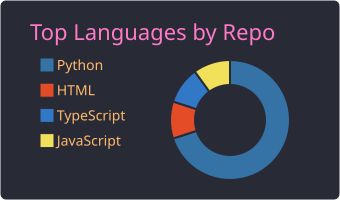

# Hi, I'm Aditya Singh 👋

### 🤖 Aspiring AI Engineer | Python · GenAI · RAG · AI Agents

*Building practical AI applications and learning by shipping real projects.*

  

---

## 🌐 My Portfolio

> ✨ **See my work, skills and background in one place.**
>
> 👉 **[portfolio-frontend-orpin-one.vercel.app](https://portfolio-frontend-orpin-one.vercel.app/)**

---

## 👨‍💻 About Me

- 🎓 B.Tech student graduating in **2027**
- 🤖 Interested in **AI Engineering, Generative AI, RAG, LLM applications, and AI agents**
- 🛠️ I enjoy connecting AI models, APIs, and retrieval systems to solve practical problems.
- 🌱 Always learning through hands-on projects and experimentation.

---

## 🚀 Featured Project

### 🎥 Video RAG: Question Answering Over YouTube Videos

A Retrieval-Augmented Generation project that helps users explore video content by asking questions and retrieving relevant context.

**✨ Highlights**

- 📥 Uses `yt-dlp` to retrieve YouTube video data.
- 🧠 Uses the **Jina API** for embeddings.
- 🔎 Retrieves relevant video context to support question answering.
- ⚡ Aims to make long-form video content easier to search and understand.

**Tech stack:** Python · Retrieval-Augmented Generation (RAG) · Embeddings · Jina API · yt-dlp

---

## 🧰 Technologies & Interests

         

*This list reflects my current focus and tools I've worked with; I'm continuing to deepen my skills.*

---

## 📊 GitHub Activity

 

 

---

## 🤝 Let's Connect

I'm happy to connect with people working on AI, discuss projects, and learn from the developer community.

  

---

*Thanks for visiting my profile! ⭐ Feel free to explore my repositories.*
